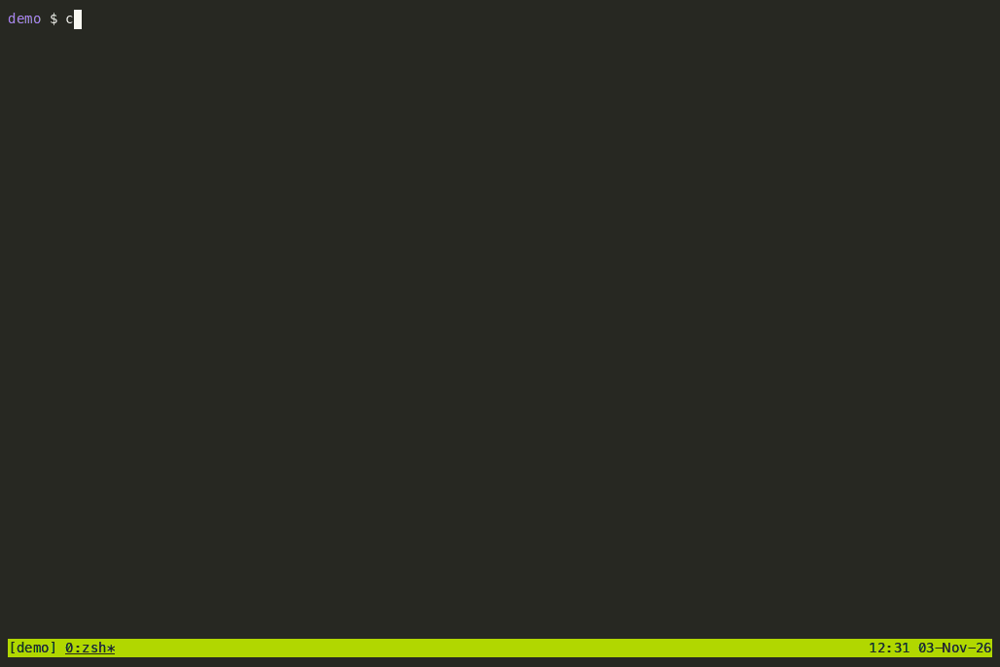

<p align="center">
  
</p>

<h1 align="center">sdlc-foundry</h1>

<p align="center">
  <strong>From a new repo to Kubernetes, declared once.</strong><br>
  Claude Code agents, slash commands and Copier templates that take a system from idea to "running in Kubernetes via GitOps".
</p>

<p align="center">
  <a href="https://github.com/ika100/sdlc-foundry/actions/workflows/ci.yml"></a>
  <a href="LICENSE"></a>
  <a href="https://ika100.github.io/sdlc-foundry/"></a>
  <a href="https://github.com/ika100/sdlc-foundry/releases"></a>
</p>

<p align="center">
  <a href="https://ika100.github.io/sdlc-foundry/"><b>Documentation</b></a> ·
  <a href="docs/QUICKSTART.md">Quickstart</a> ·
  <a href="docs/USER-JOURNEY.md">User journey</a> ·
  <a href="docs/HOW-IT-WORKS.md">How it works</a> ·
  <a href="https://ika100.github.io/sdlc-foundry/reference/commands/">Commands</a> ·
  <a href="docs/CHANGELOG.md">Changelog</a>
</p>



*A real run on public demo repos ([demo-taskboard-api](https://github.com/ika100/demo-taskboard-api), [demo-taskboard-gitops](https://github.com/ika100/demo-taskboard-gitops)), with every wait cut: [about 30 minutes of work](docs/BASELINES.md#the-2026-11-03-demo-run) shown in 4. The ship run stops once to ask about a formatter change to the acceptance tests; that is part of the run, not edited out.*

You describe what you want in Claude Code; sdlc-foundry scaffolds the repositories (Python, Java, Go and Next.js services, plus one GitOps repository per system), turns your sentence into a spec with acceptance criteria, builds it test-first, merges it on green CI and lets Argo CD deploy it. Every Kubernetes manifest is rendered from one declarative file, `system.yaml`.

## Why

- **One file says what runs where.** Databases, buckets, caches, secrets, observability and policies are one declaration each in `system.yaml`; promotion between environments is a reviewed pull request.
- **Specs drive the agents.** A feature starts as numbered acceptance criteria you approve; failing tests come first, then the code, then a review against every criterion.
- **Deterministic where it can be.** Everything that can be code is a tested CLI (`cplat`); agents orchestrate it and ask before anything leaves your machine.
- **Runs unattended.** Approve a spec and come back to it running in dev. The [recorded journeys](https://ika100.github.io/sdlc-foundry/get-started/watch-a-run/) show the whole path to prod with every pull request.

## Quickstart

You need Claude Code, `git` and a logged-in `gh`, `uv`, [devbox](https://www.jetify.com/devbox) and Docker. In Claude Code:

```text
/plugin marketplace add ika100/sdlc-foundry
/plugin install shared@sdlc-foundry
/plugin install system@sdlc-foundry
/plugin install component@sdlc-foundry
/plugin install platform@sdlc-foundry
```

Restart Claude Code, run `/platform:doctor`, then:

```text
/system:new taskboard.yaml                       # a GitOps repo and one repo per component
devbox run cluster-up                            # in taskboard-gitops, after merging its PR: a local cluster
/component:spec "create and list tasks"          # in taskboard-api: a spec you approve
/component:ship 001                              # plan, test, build, merge, running in dev
```

**[Follow the full quickstart →](docs/QUICKSTART.md)** It has the manifest, what each step shows and how long it takes: about 15 minutes to a running endpoint, 40 to a shipped feature.

## Learn more

| | |
|---|---|
| [Documentation site](https://ika100.github.io/sdlc-foundry/) | Vision, concepts, scenarios and every guide, with search |
| [User journey](docs/USER-JOURNEY.md) | One system from an empty folder to prod, chapter by chapter |
| [How it works](docs/HOW-IT-WORKS.md) | The flow in diagrams |
| [Commands](https://ika100.github.io/sdlc-foundry/reference/commands/) | Every slash command, generated from the plugins |
| [Adopting](docs/ADOPTING.md) | Existing repos, migrating from 4.x, troubleshooting |
| [The local console](docs/console.md) | `/platform:ui`: what waits for you, every change by stage, where each component runs |
| [Changelog](docs/CHANGELOG.md) · [ADRs](docs/adr/README.md) | What changed and why |

To run your own variant, fork the repository, change the owner in `.claude-plugin/marketplace.json` and add your fork with `/plugin marketplace add <you>/sdlc-foundry`. Code generated from the templates is yours; this repository's license does not apply to it.

## Disclaimer, privacy, AI-assisted development

- **Not affiliated.** sdlc-foundry is an independent open-source project, not affiliated with, sponsored by or endorsed by Anthropic or the owners of the other names it mentions (see [THIRD_PARTY_NOTICES.md](THIRD_PARTY_NOTICES.md)). *Claude* and *Claude Code* are trademarks of Anthropic, PBC.
- **Non-commercial.** sdlc-foundry is a private, non-commercial hobby project: no paid services, sponsorship, advertising or business stands behind it or its name.
- **No warranty.** The software is provided "as is" under the [Apache License 2.0](LICENSE) (sections 7 and 8). Review what it generates (manifests, workflows, policies) before it touches a production cluster; the platform never runs `kubectl apply` on its own, and humans bootstrap real clusters.
- **No telemetry.** The plugins and the `cplat` CLI send nothing anywhere on their own. Network access is what you would expect: `git`/`gh` against GitHub, package registries, GHCR. Generated applications export telemetry only to the endpoint you configure. `/issue:report` shows you the full text first and files it only after your OK; **issues on this repository are public**, and the draft already has tokens, e-mail addresses and home-directory names removed.
- **AI-assisted.** Much of this repository was written with Claude Code and reviewed, tested and committed by the maintainer (commits carry a `Co-Authored-By` trailer). Licensing is the maintainer's: AI-generated parts may be subject to limited copyright protection depending on jurisdiction.

## Contributing, security, support

- [CONTRIBUTING.md](CONTRIBUTING.md): setup, checks, PR rules and how releases reach consumers. [Code of Conduct](CODE_OF_CONDUCT.md).
- [SECURITY.md](SECURITY.md): report vulnerabilities privately. [SUPPORT.md](SUPPORT.md): where to ask questions.
- Something misbehaves? Run **`/issue:report`** in Claude Code: it drafts an issue with your versions and the error, removes tokens, e-mail addresses and home-directory names, and files it only after your OK. Or open one by hand: [new issue](https://github.com/ika100/sdlc-foundry/issues/new/choose).

## License

[Apache License 2.0](LICENSE). Copyright 2026 Eike Hensler.
