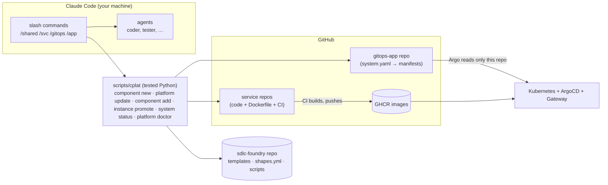
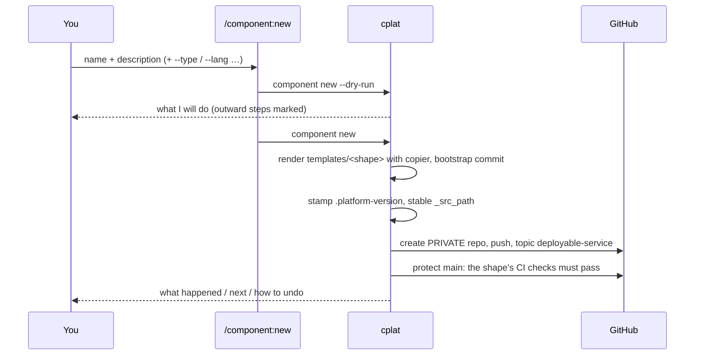
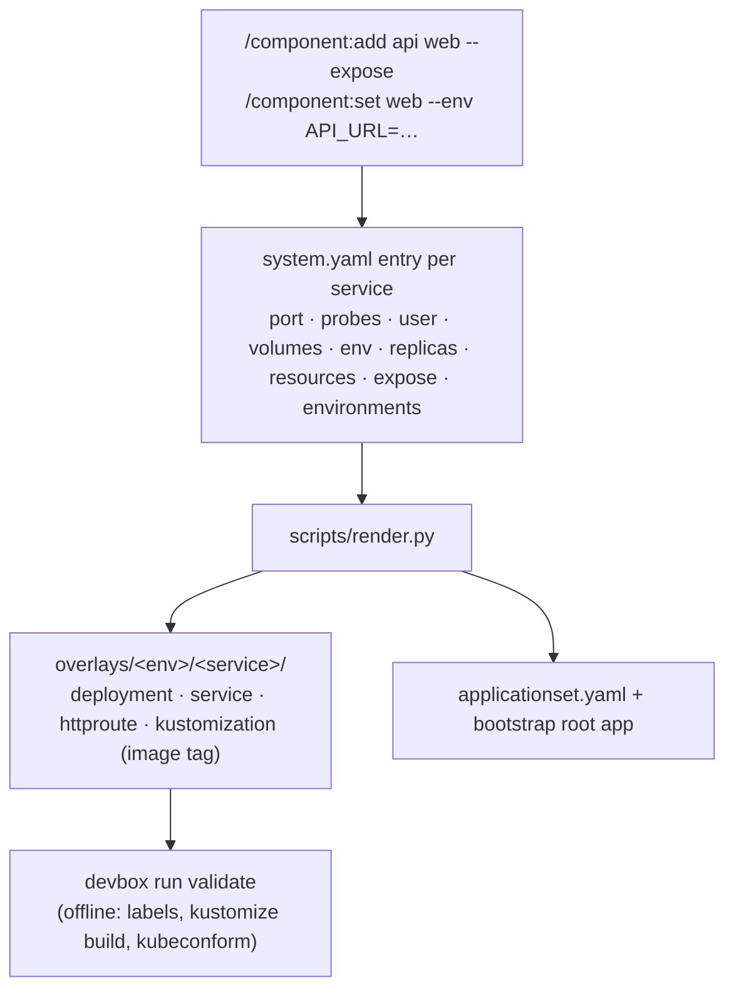
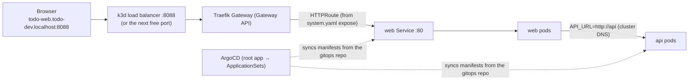

# How it works

What actually happens when you use the platform — read this when a command surprises you. For the guided tour see [USER-JOURNEY](USER-JOURNEY.md); for the nouns (system, component, environment, instance, spec, run) see the [domain model](DOMAIN-MODEL.md); for decisions see the ADRs.

## The map

[Open the map full size](img/sdlc-map.svg)

You decide at three points: route an issue, approve its spec, promote to prod. `/component:ship` runs everything in the green band: agents do the judgement work (spec, design, code, review), `cplat` every step that can be code (checks, pushes, waits, merges, pins, smoke tests). Red CI goes back to the coder that owns the files, a merge conflict back to the architect; after three red rounds, or on a decision the spec does not answer, the run escalates to you. `/system:ship` does the same for a system, repo by repo in plan order.

## Feedback loops

What happens in runs and in running systems comes back as data or as a deduplicated issue. The loops file and propose; you route issues in `/issue:triage` and approve specs. Setup for each: [unattended delivery](unattended-delivery.md).

| Loop | Signal | Lands in |
|---|---|---|
| [Run records](unattended-delivery.md#run-records) (087, 099) | phases, CI rounds, escalations, tokens and cost of every run | the private run store, `cplat platform runs report` |
| [Agent quality](unattended-delivery.md#agent-metrics) (089) | fix rounds, red CI, review findings, re-plans per agent, shape and model | the run store, `cplat platform runs report --agents` |
| [Weekly retro](unattended-delivery.md#weekly-retro) (090) | the last complete week against the one before | a `Weekly retro` issue with evidence-checked spec proposals |
| [Platform failures](unattended-delivery.md#auto-filed-platform-issues) (088) | an escalation with cause `platform`, a `cplat` crash | one issue per signature in `ika100/sdlc-foundry` |
| [Smoke in dev](unattended-delivery.md#smoke-in-dev) (091) | the spec's `(smoke)` criteria against the deployed service | a `smoke-failure` issue in the service repo |
| [Firing alerts](adr/038-alert-poll-on-the-gitops-runner.md) (092) | alert rules of the `observability` setting of an environment and `ServiceDown` | an issue with an `env:` label in the owning repo |
| `/issue:report` | anything a person or agent hits, secrets removed | an issue, filed after your OK |

## The moving parts

Commands are thin: they run `cplat` with `--dry-run`, show you the plan, run it, and relay the report. Anything that can be code is code (and has tests); agents do the creative work (design, implement, review).

## 1. Create a repo — `/component:new`

The shape (`service-python`, `web-nextjs`, `gitops-app`, …) is looked up in `shapes.yml`; it decides the template, the plugin whose agents work on the repo, whether the repo is deployable, and which CI checks (`ci_checks`) must pass before anything merges into `main` — the repo is created with that branch protection (no review requirement; where your GitHub plan cannot protect private repos, the command warns and prints the manual step).

## 2. Build a feature — `/component:spec`, `/component:plan`, `/component:build`

`cplat shape` detects the shape (from `.copier-answers.yml`) and prints which agent to use for each role. A feature is a folder `docs/specs/<NNN>-<slug>/` ([ADR-026](adr/026-feature-specs.md)): `/component:spec` has the product-manager write `spec.md` (acceptance criteria `AC-<NNN>.<n>`, open questions that you answer, then your approval); `/component:plan` has the architect write `design.md` and `plan.md` (tasks that `cover` criteria). `/component:build` then writes failing acceptance tests named after the criteria, runs coders in parallel git worktrees until they pass, runs quality ‖ tester ‖ security, has a reviewer check every criterion (`verification.md`), checks the container image and opens a PR. Every check on a spec — ids, coverage, drift between spec and plan, test trace, status — is `cplat spec`, not prose. Every generated repo also runs it in CI: the warn-only `specs` workflow (`devbox run spec-check` locally) validates all specs and fails, once strict, when a criterion of a spec being built has no test. Acceptance tests may be reformatted by `lint-fix` but never weakened: the build compares them with the red commit (`cplat spec test-diff`) and stops on anything but formatting. An interrupted build resumes where it stopped (`/component:build <id>` again). CI re-runs the same `devbox run` recipes and, on merge to `main`, builds the image natively for amd64 and arm64 and publishes `latest` and `sha-<7>`.

`cplat spec trace <id> --chain [--json]` shows, per criterion, the whole chain from the tracked issue to the running environment: spec, criterion, tests, reviewer verdict, merged PR, release and the tag pinned in dev, staging and prod (read from the linked gitops-app, never the cluster). Each link is `ok`, `missing`, `stale` (the criteria changed after they were verified), `unknown` (it could not be read, so it is never guessed) or `n/a` (a draft spec, a library without environments, an unlinked repo). It only reads and always exits 0, so it is a report, not a gate. Offline, or without `gh`, it makes one attempt of at most 10 s, marks the links that need GitHub `unknown` and ends with a note naming what was not reached. `spec ci` also warns, never fails, about a test that names a withdrawn or unknown criterion.

## 3. Declare how it runs — `/component:add`

Services ship only an image. The **gitops-app repo owns every Kubernetes manifest** (ADR-017):

Defaults come from `shapes.yml → runtime` and are written *into* the entry, so what you review in the PR is exactly what runs. Wiring between services (`env: {API_URL: http://api}`), the postgres resource (`uses: [postgres]`), exposure, replicas and resources are system configuration and live here; `/component:set <component>` changes them on a component that is already added. New services start in `dev` only.

A feature built across the system with `/system:ship` carries this wiring as data: the system plan's gitops-app entry lists `gitops:` operations (adding the postgres resource, `uses`, `expose`, `env` on a component), which `/system:ship` runs with `cplat resource add` and `cplat component set` in this repo. Its PR is marked **merge first**, because the services rely on it.

## 4. Promote — `/instance:promote`

`dev` follows `main`: after each merge the service's CI asks the gitops-app to pin `dev` to the new `sha-<40>` (the full commit sha, ADR-030); the gitops-app's `pin-dev` workflow opens that pin PR and merges it once CI passes ([ADR-027](adr/027-dev-follows-main-through-pin-prs.md)). The one manual step per service is the `GITOPS_TOKEN` secret that `/component:new` names; without it `dev` stays on its last pin. `promote … --to staging` adds a `staging` instance to the component and pins `sha-<40>` of a build of the service's `main`; `promote … --to prod` pins the release image `X.Y.Z` (the `vX.Y.Z` git tag without the `v`). Before opening the PR the script checks the tag exists in GHCR, so a promotion can never point at an image CI has not finished. One PR per invocation; rollback = revert. Staging follows a green dev smoke too (spec 093, [ADR-041](adr/041-staging-follows-green-dev-smoke.md)): when `promote: after-dev-smoke` is set on the `staging` environment in `system.yaml` (new gitops-apps have it), `cplat component ship deploy` dispatches the gitops-app's `pin-staging` workflow, which opens a self-merging PR that runs CI and pins staging, then smokes staging. Switch it off with `promote: manual` on the `staging` environment in `system.yaml`, or per component on its `staging` instance. Prod is never automatic: `promote … --to prod` prints an evidence summary first and its PR is reviewed.

## 5. Run it and reach it

`devbox run cluster-up` builds this locally (on port 8088, or the next free port when 8088 is taken — it prints the URL): k3d, ArgoCD, Traefik's Gateway provider, your `gh` token as repo credential and GHCR pull secret, the root Application. `*.localhost` hostnames resolve to 127.0.0.1 with no DNS setup. On a real cluster a human runs `KUBE_CONTEXT=<ctx> devbox run bootstrap` once; from then on every change arrives through merged PRs and agents never run `kubectl apply`.

### Secrets

Git holds only references. `system.yaml` `secrets:` becomes `ExternalSecret`s: `generate: [DB_PASSWORD]` makes External Secrets Operator create a random value in the cluster once per environment; `remote: {keys: [STRIPE_KEY]}` reads it from the secret store (locally the `secrets-store` namespace: `/instance:secret set <service> <secret> <KEY>`; on real clusters Vault/AWS/GCP via the store named in `system.yaml`). Pods see them as environment variables. Details: ADR-018.

### Resources (Postgres)

`/resource:add postgres` declares a database for the application; a service opts in with `uses: [postgres]` (`/component:add <svc> --uses postgres`). The platform renders a CloudNativePG `Cluster` for each environment where a service uses it and injects `DATABASE_URL` and `PG*` from the operator's Secret. Removing the resource never deletes the data; backups and pooling are not provided. Details: ADR-020.

### Observability (OpenTelemetry)

Setting `observability` on an environment in `system.yaml` (`environments.<env>.observability`) puts an OpenTelemetry Collector next to your services in that environment and points them at it with the standard `OTEL_*` variables. The collector receives OTLP and scrapes each service's Prometheus endpoint. Where the data goes is your choice: `exportTo: <OTLP/HTTP endpoint>` for your own backend, or `ui: lgtm` for a local Grafana dev stack (`http://grafana.localhost:8088 (or the port cluster-up prints)`, installed by `cluster-up`). Details: ADR-021.

### Guard rails (Kyverno)

Set `policy: audit` (or `enforce`) on an environment in `system.yaml` and the platform renders Kyverno policies for it that encode its own conventions (non-root, read-only filesystem, limits, allowed registries, no `:latest` outside dev). `devbox run validate` checks the rendered manifests against them before merge; in the cluster they run in the mode the environment's `policy` names (`audit`, `enforce`; `off` renders none). Details: ADR-022.

## 6. Keep it current

- Agents/commands: `claude plugin marketplace update sdlc-foundry && claude plugin update <name>@sdlc-foundry`, then **restart Claude Code** (a running session keeps the old prompts). `/platform:doctor` tells you when that is needed.
- Skeleton (CI, Dockerfile, devbox recipes, CLAUDE.md): `/platform:update` re-applies the template on a review branch; project-owned files are never touched.
- Overview: `/system:status --context <kube-context>`; setup check: `/platform:doctor`.

## What protects you (and where it is tested)

| Risk | Guard |
|---|---|
| A template regresses | `shapes.py check` (contract), `actionlint`, smoke jobs that build and start every image read-only, `tests/cplat` (unit/integration), `tests/e2e` (real cluster) |
| A promotion points at a missing image | `promote` verifies the tag in GHCR |
| Invalid Kubernetes YAML | offline `validate` in every gitops repo + server-side dry-run in the e2e test |
| A command's behaviour drifts from its docs | the command *is* the tested script; prompts only wrap it |
