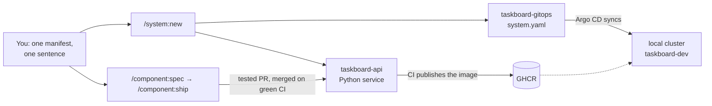

# Quickstart: from an empty folder to a shipped feature

In about **15 minutes** you have a Python API running in a local Kubernetes cluster, deployed by Argo CD from its own GitOps repository. About **25 minutes** later a feature you described in one sentence is specified, tested, merged and running there. Most of that time is CI and the cluster working; your part is a few commands and a couple of answers.

You type slash commands in Claude Code, or just say what you want ("create a system with one Python API") and Claude runs the matching command. Every step below shows the command.

## Before you start

| You need | Check |
|---|---|
| [Claude Code](https://claude.com/claude-code) | `claude --version` |
| A GitHub account and [`gh`](https://cli.github.com), logged in | `gh auth status` |
| [`uv`](https://docs.astral.sh/uv/) | `uv --version` |
| [`devbox`](https://www.jetify.com/devbox) | `devbox version` (install: `curl -fsSL https://get.jetify.com/devbox/install.sh \| bash`) |
| Docker, running | `docker info` |

You do not install `kubectl`, `k3d`, Argo CD or any language toolchain: each generated repository brings its own through `devbox`.

## 1. Install the plugins (2 minutes)

Start Claude Code in an empty folder and run:

```text
/plugin marketplace add ika100/sdlc-foundry
/plugin install shared@sdlc-foundry
/plugin install system@sdlc-foundry
/plugin install component@sdlc-foundry
/plugin install platform@sdlc-foundry
```

**Restart Claude Code** (a running session keeps the old commands), then check your machine:

```text
/platform:doctor
```

**You will see** one row per check (tools, `gh` scopes, Docker, plugin versions), each `ok` or with the exact command that fixes it.

**If a row fails:** run the fix it prints and run `/platform:doctor` again. A missing `gh` scope is fixed with `gh auth refresh -s repo,workflow,read:packages`.

The four plugins are the starter set. Repositories created by the platform enable every other plugin they need (`instance`, `resource`, `api`, the language agents) in their own `.claude/settings.json`.

## 2. Create the system (3 minutes)

Save this as `taskboard.yaml`, with your GitHub user or organisation as `owner`:

```yaml
system: taskboard
owner: <your-github-user>
components:
  - {name: taskboard-api, description: Task API, type: service, lang: python}
```

Then run:

```text
/system:new taskboard.yaml
```

**You will see** a plan first: which repositories it creates and which steps reach GitHub, marked `[outward]`. Nothing happens until you say yes. Then it creates two private repositories, `taskboard-gitops` (what runs where) and `taskboard-api` (the service, from the Python template), and opens a pull request in `taskboard-gitops` that adds the API to its `system.yaml`. It ends with the next steps.

**If it stops:** a name that is taken or invalid is refused before anything is created; change it in `taskboard.yaml`. If it stops halfway (a dropped network), run `/system:new taskboard.yaml --resume`.

## 3. Run it in a local cluster (7 minutes)

Open Claude Code in the new `taskboard-gitops` folder.

1. Merge the pull request from step 2 once its CI is green.
2. Start the cluster:

   ```bash
   devbox run cluster-up
   ```

   It creates a k3d cluster with Argo CD and the Gateway API, and prints its URLs. The first run takes about two minutes.
3. Make the API reachable from your browser:

   ```text
   /component:set taskboard-api --expose
   ```

   This opens one pull request with the route; merge it when CI is green.

**You will see** the API answer within a minute or two of the merge:

```bash
curl http://taskboard-api.taskboard-dev.localhost:8088/health
```

**If it does not answer:** run `/system:status` for one table of what runs where and whether Argo CD is synced. Port 8088 taken? `cluster-up` picks the next free port and prints it. More in [Run it on your laptop](https://ika100.github.io/sdlc-foundry/get-started/local-cluster/).

## 4. Describe a feature (5 minutes)

Open Claude Code in the `taskboard-api` folder:

```text
/component:spec "create and list tasks, each with a title and an optional due date, kept in memory"
```

**You will see** a spec with numbered acceptance criteria, the assumptions it made for you, and at most a few questions. Answer them, read the criteria, then approve:

```text
/component:spec approve 001
```

**If the spec is not what you meant:** say what to change ("titles up to 200 characters"); it amends the spec before you approve.

## 5. Ship it (about 20 minutes)

```text
/component:ship 001
```

**You will see** it work on its own: a design and a plan, failing acceptance tests written from your criteria, code until they pass, quality and security checks, a pull request, the merge on green CI, and the wait until dev runs the new image. It stops only when it needs a decision from you.

When it reports done:

```bash
curl http://taskboard-api.taskboard-dev.localhost:8088/tasks
```

**If it stops and asks:** answer, and it continues. If the session ends, run `/component:ship 001` again; it resumes where it stopped.

## What just happened



- **One file says what runs where.** `system.yaml` in the GitOps repository lists the components, their resources and environments; every Kubernetes manifest is rendered from it.
- **Specs drive the code.** Your sentence became acceptance criteria, the criteria became tests, and the build was done when they passed.
- **Pull requests are the only way in.** Every change, including the deployment, was a reviewed pull request that Argo CD then applied.

## Next steps

- Add a database: `/resource:add postgres --type database`, then `/component:set taskboard-api --uses postgres`. See [Add-ons, secrets and observability](https://ika100.github.io/sdlc-foundry/scenarios/addons-secrets-observability/).
- Add a web UI and ship one spec across both repos: [User journey](USER-JOURNEY.md), chapters 2 to 4.
- Promote to staging and prod: [Promote safely](https://ika100.github.io/sdlc-foundry/scenarios/promote-safely/).
- See what waits for you in a browser: `/platform:ui` ([the local console](console.md)).
- Watch the whole path recorded, from an empty folder to prod: [Watch a real run](https://ika100.github.io/sdlc-foundry/get-started/watch-a-run/).

## Clean up

```bash
devbox run cluster-down              # in taskboard-gitops: removes the cluster and its registry
gh repo delete <owner>/taskboard-api --yes
gh repo delete <owner>/taskboard-gitops --yes
```

Something broken? Run `/issue:report`: it drafts an issue with diagnostics, secrets removed, and files it only after your OK.
