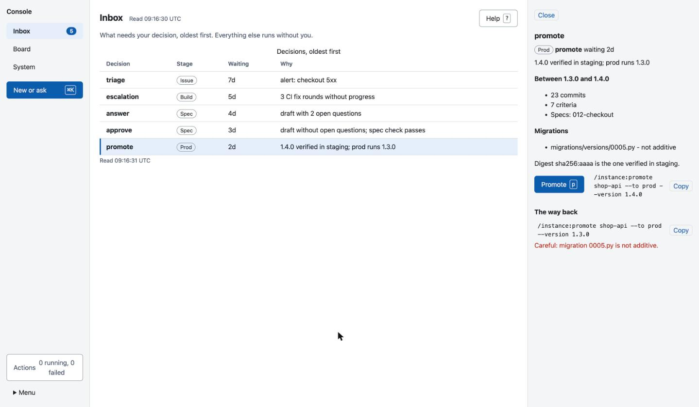
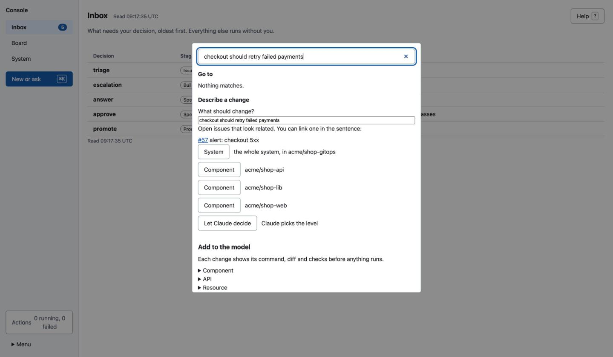
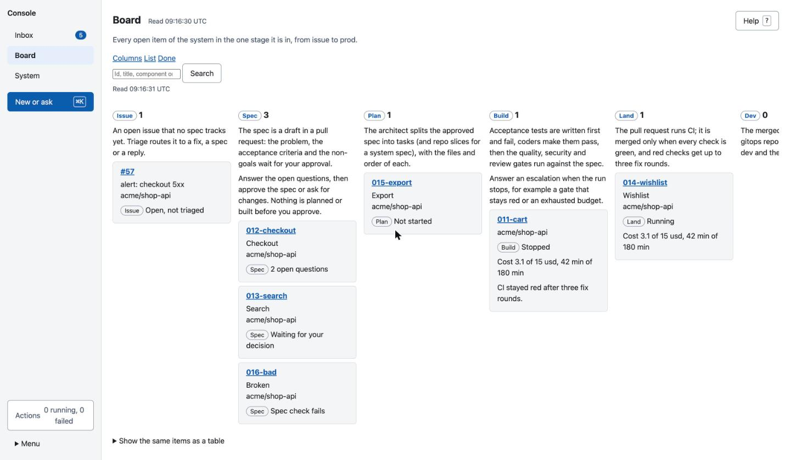
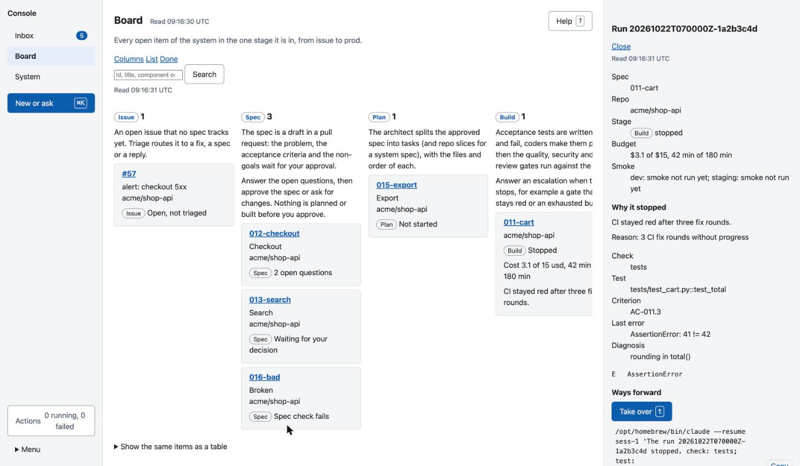
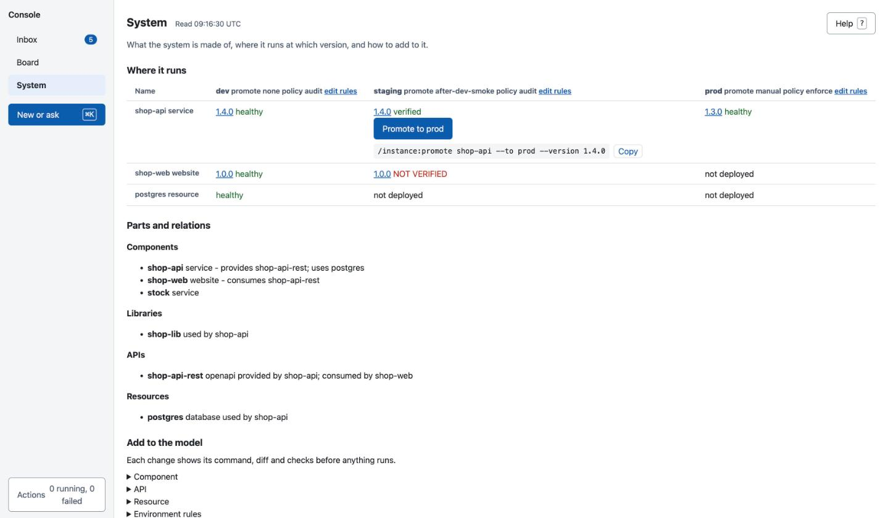
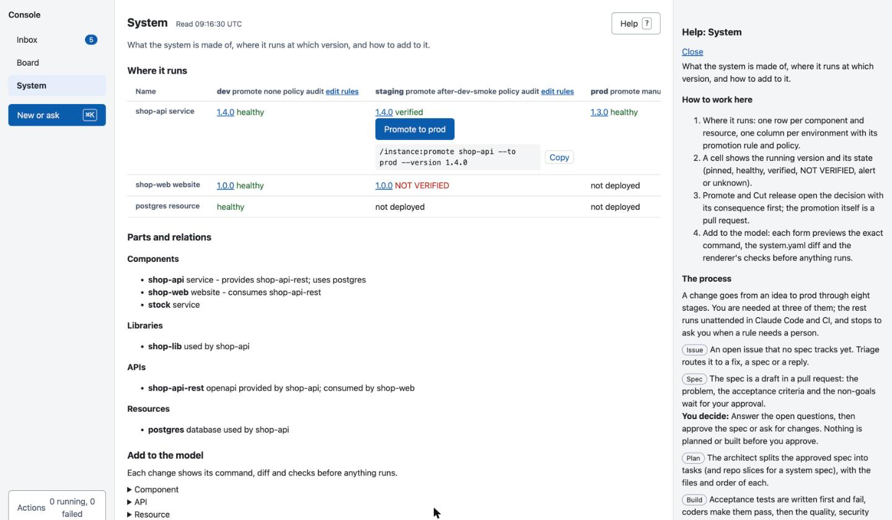
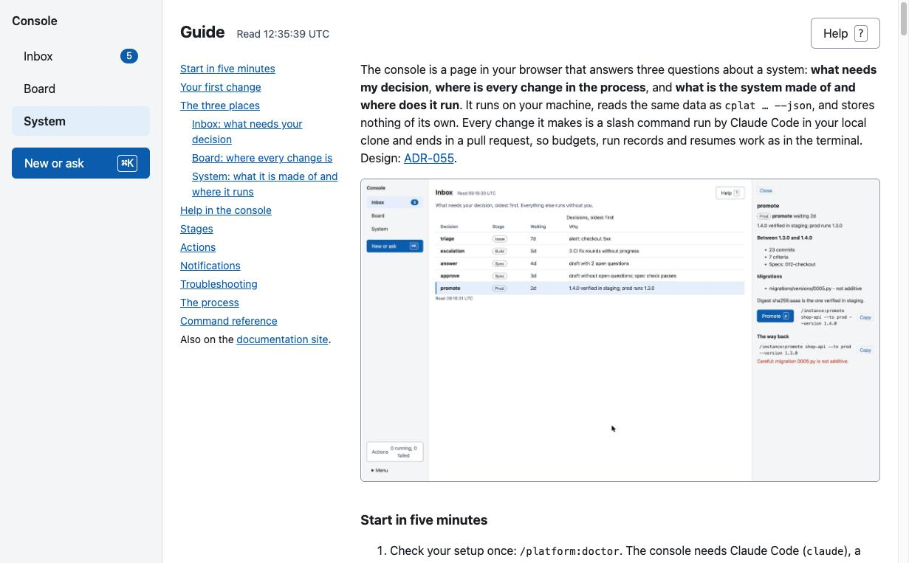

# The local console

The console is a page in your browser that answers three questions about a system: **what needs my decision**, **where is every change in the process**, and **what is the system made of and where does it run**. It is optional: everything it does is a slash command you can also run in Claude Code. It runs on your machine, reads the same data as `cplat … --json`, and stores nothing of its own. Every change it makes is a slash command run by Claude Code in your local clone and ends in a pull request, so budgets, run records and resumes work as in the terminal. Design: [ADR-055](adr/055-local-console-over-cplat-json.md).



## Start in five minutes

1. Check your setup once: `/platform:doctor`. The console needs Claude Code (`claude`), a logged-in `gh`, and a kube context per environment for promotions. It starts without them and tells you what is missing.
2. In a clone of the system's `gitops-app` repo, start it:

   ```
   /platform:ui                  # or: cplat ui
   /platform:ui --no-open        # print the URL, do not open the browser
   /platform:ui --port 8800      # fixed port; default is a free one
   ```

3. The browser opens on the **Inbox**. Press `?` on any page for help on that page, `g` for this guide inside the console (also **Menu → Guide**), or `⌘K` (`Ctrl+K`) to start something.

The server listens on `127.0.0.1` only. Stop it from **Menu → Stop console** (it asks first while actions run) or by ending the process. To work on another system, use **Menu → Switch system**: it lists the `gitops-app` repos of your GitHub account and organisations, and clones a missing one under `workspace` (default `~/src`).

## Your first change

1. Press `⌘K`, type what should change in one sentence, for example "checkout should retry failed payments".
2. Pick the level: **System** (several repos), one **Component**, or **Let Claude decide**. Related open issues are listed so you can name one in the sentence.
3. The product manager agent writes a draft spec with acceptance criteria and open questions, and opens it as a draft pull request. It appears in the Inbox as **answer** (questions open) or **approve**.
4. Answer the questions in the Inbox, then choose **Approve & ship** with a budget. From here the run plans, builds, tests, reviews, merges and deploys to dev and staging without you, and comes back to the Inbox only if it needs you.
5. When staging has verified the release, it waits in the Inbox as **promote**. Read what it changes, then promote it to prod.



## The three places

### Inbox: what needs your decision

The Inbox lists every open decision, oldest first: a draft spec to **answer** or **approve**, a run that stopped (**escalation**), a release to **promote**, and an alert or failed smoke to **triage**. The sidebar badge shows how many there are.

Select one (`j`/`k`, `Enter`) and decide in the side panel. Each decision shows:
- **the consequence**: for a promotion the commits, specs, criteria and migrations between the running and the new version and whether the digest is the one staging verified; for an approval the repos, the stages that run without you and the expected cost;
- **the command** it runs, with a copy button;
- **the way back**: for a promotion the command that promotes the previous version again, with a warning when a migration in between is not additive.

Nothing runs before you click the button (or press its key: `a` approve, `p` promote, `t` take over, `o` open in Claude Code).

### Board: where every change is



One column per stage, from **Issue** to **Prod**; every open item sits in exactly one. **Spec**, **Build** and **Prod** are decision columns. Select a column header to see what happens in that stage, which agents work there, the commands, and what you decide. A run card shows its budget used of its limit, and a stopped run says why in one line.

Open a card for its detail: the stage strip, one line per repo slice, every acceptance criterion with its test and verdict, the evidence chain from issue to running instance (pull request, CI, image, instance), and the latest activity. A stopped run explains itself: why it stopped, the failing test and its criterion, the last error and the diagnosis, and the ways forward (take over in Claude Code, more budget, amend the spec).



**List** shows the same items as a table; **Done** lists what finished in the last 30 days, 90 days or all time; search finds spec ids, title words, component names and `#issue` numbers.

### System: what it is made of and where it runs



**Where it runs** has one row per component and resource and one column per environment with its promotion rule and policy. A cell shows the running version and its state: `pinned`, `healthy`, `verified` (smoke passed), `NOT VERIFIED`, `alert`, or `unknown` when the cluster cannot be read. A verified cell before a manual environment offers **Promote**, and a verified version newer than the last release offers **Cut release**; both open the decision with its consequence first.

Below are the components, libraries, APIs and resources with their relations, and **Add to the model**: forms for a component, an API (`/component:add|set --provides|--consumes`), a resource, environment rules (`/system:set --env`) and a new system. Each change previews the exact command, the `system.yaml` diff and the renderer's checks on a scratch copy before anything runs; an invalid value names the key and the rule.

## Help in the console

Every page has a one-line answer under its title and a **Help** button (or `?`). The help explains how to work on that page, the eight stages and where you decide, the keys, and where the data comes from. The whole guide is in the console too (**Menu → Guide** or `g`): this text with its screenshots, the process with every stage, and a reference of every command with its usage and a copy button.





## Stages

| Stage | What happens | You decide |
|---|---|---|
| Issue | An open issue no spec tracks; `/issue:triage` routes it | |
| Spec | A draft spec in a pull request waits for you | answer the questions, approve or request changes |
| Plan | The architect splits it into tasks | |
| Build | Tests first, then code, then quality, security and review gates | answer an escalation |
| Land | CI on the pull request; merged only when green | |
| Dev | Pinned in the gitops repo, rolled out by Argo CD, smoke checked | |
| Staging | Smoke verified in staging; the digest becomes a release candidate | |
| Prod | A verified release waits for promotion | promote |

The console names every item with these stages only; spec statuses and run phases are not shown as names of their own.

## Actions

A button runs one slash command through `cplat headless` in the right clone: approve, approve and ship, request changes, answer, promote, more budget, amend, fix, make a spec, dismiss, cut a release, describe new work, or a model change. The activity indicator (bottom left) shows how many run and how many failed; its panel shows each one's command, current step and result with links to the run and the pull request, and **Retry** or **Open in Claude Code** on failure. One action runs per object at a time. "Open in Claude Code" resumes the run's session in its repo with the failure loaded, or starts a new one.

## Notifications

`cplat ui` starts the notifier. Without the console open, schedule it:

```
*/5 * * * *  cplat ui notify --once        # cron; use a launchd StartInterval job on macOS
```

Choose channels in `~/.config/sdlc-foundry/notify.yaml` (shown under **Menu → Settings**):

```yaml
preset: recommended          # GitHub and desktop for decisions and alerts
events:                      # approve answer escalation promote alert smoke run-done retro
  promote: {github: instant, slack: digest}
slack: {channels: ["#shop-dev"]}
email: {to: me@example.com, from: cplat@example.com, host: smtp.example.com, port: 587, user: me}
digest: {at: "09:00", days: [mon, tue, wed, thu, fri]}
quiet_hours: "22:00-07:00"
```

Values are `off`, `instant` or `digest` (`digest` for Slack and email only). Each event is sent once per channel. Quiet hours hold instant sends, except an alert on prod; held events go into the next digest. When someone resolves an event anywhere, its card leaves the Inbox, the notification issue is closed, and the next digest marks it done.

Secrets never go in the file (it refuses `webhook`, `url`, `password`, `token`). Set `CPLAT_SLACK_WEBHOOK_<CHANNEL>` (`#shop-dev` becomes `SHOP_DEV`) and `CPLAT_SMTP_PASSWORD` in the environment, or store them in the OS keychain under service `sdlc-foundry` (accounts `slack-webhook:#shop-dev`, `smtp:<user>@<host>`).

## Troubleshooting

- **A banner names a missing piece.** Run `/platform:doctor`; it checks `claude`, `gh` and the kube context per environment, and every notification channel that is on but lacks a webhook, address, host or password. Actions that need the missing piece are disabled and say so; their commands can still be copied.
- **A part says "unavailable since …".** A source (GitHub, a cluster, a `cplat` call) failed. Its last data stays, marked stale; health it cannot read shows as `unknown` and actions that depend on it are off. It retries every 30 seconds, or choose **Retry now**.
- **An action failed.** Open the activity panel for the reason and the last lines of output, then **Retry** or **Open in Claude Code**. Action logs are under `${XDG_STATE_HOME:-~/.local/state}/sdlc-foundry/console/actions/`.
- **"needs a local clone".** Clone the repo under your workspace, or use **Menu → Switch system**.
