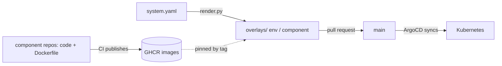

A system has one **GitOps repository** (shape `gitops-app`). It contains, per system, one file, `applications/<system>/system.yaml`: the environments (host, policy, observability, promotion), the components and how each runs (image, port, probes, env, secrets, `uses`, `instances`), the APIs and the resources.

`scripts/render.py` derives everything else (`devbox run render`): per environment and component a Deployment, Service, optional `HTTPRoute`, `ExternalSecret`s and a `kustomization.yaml` that pins the image tag, plus the ArgoCD ApplicationSets and a root Application. `devbox run validate` fails if the tree differs from what would be rendered, so generated files cannot be edited by hand.

**Components ship only an image.** A component repository has no Kubernetes files, so Kubernetes defects cannot hide in many repositories, and nothing in CI or ArgoCD needs credentials to read other repositories ([ADR-017](/sdlc-foundry/reference/adr/017/)).

ArgoCD owns reconciliation. Agents and scripts never `kubectl apply`; real clusters are bootstrapped once by a human.
